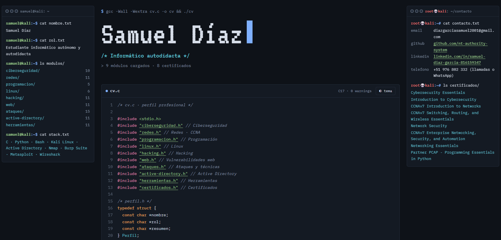

# CV Web · Samuel Díaz

Mi CV como página web escrita con la sintaxis del lenguaje C: cada sección es una construcción de C (`enum`, arrays, `#define`, funciones) y el diseño imita una terminal de Linux.

🔗 **Demo en vivo:** https://nt-authority-system.github.io/



## Características

- Código en C al centro, información a la izquierda y contacto a la derecha
- Tema claro/oscuro
- Galería de certificados Cisco con vista ampliada
- Todo el contenido se edita desde un único objeto `CV` en `script.js`

## 🛠️ Tecnologías

HTML, CSS y JavaScript puro, sin frameworks ni dependencias. Solo usa fuentes de Google Fonts.

## 📁 Estructura

```text
.
├── index.html
├── style.css
├── script.js
└── Images/        # certificados
```

## 📬 Contacto

- GitHub: [nt-authority-system](https://github.com/nt-authority-system)
- LinkedIn: [Samuel Díaz](https://www.linkedin.com/in/samuel-diaz-garcia-816159347/)
